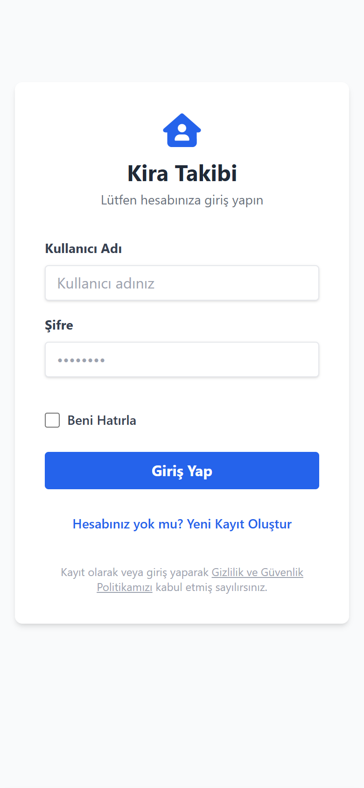
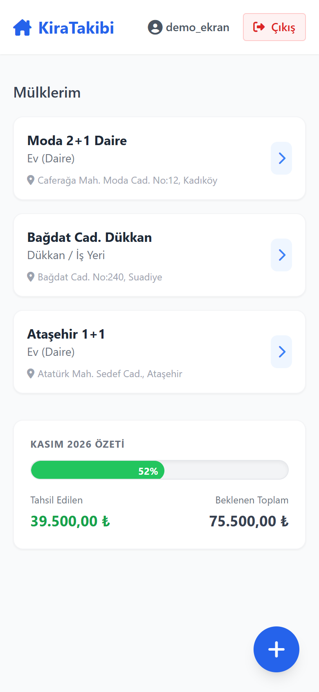
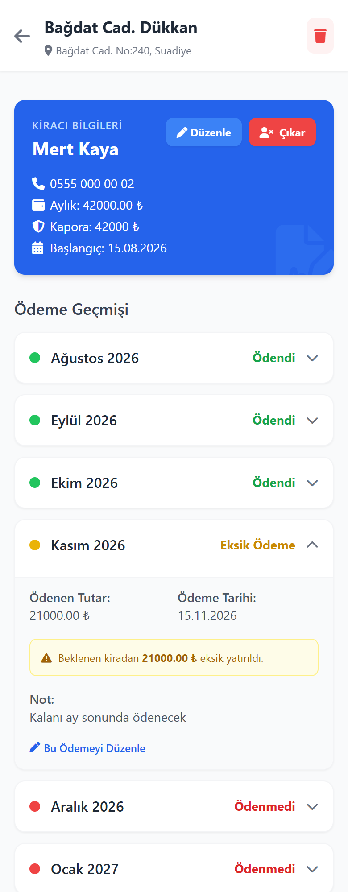

# 🏠 Kira Takibi

Ev sahiplerinin mülklerini, kiracılarını ve aylık kira ödemelerini tek bir yerden takip edebildiği bir web uygulaması.

🔗 **Canlı demo:** [burak1h.pythonanywhere.com](https://burak1h.pythonanywhere.com/login)

  
  &nbsp;
  
  &nbsp;
  

Ekran görüntülerindeki tüm veriler örnek amaçlı uydurulmuştur.

## Özellikler

- **Mülk yönetimi:** Daire, dükkân gibi mülkleri ekleme, listeleme ve silme
- **Kiracı ve sözleşme:** Mülke kiracı eklerken sözleşme otomatik oluşturulur ve **12 aylık ödeme takvimi** kendiliğinden hazırlanır. Ayın 31'i gibi günler kısa aylara göre ayarlanır.
- **Ödeme takibi:** Her ay *ödendi*, *eksik ödendi* veya *ödenmedi* olarak işaretlenir. Kısmi ödemede kalan tutar otomatik hesaplanır, ödeme tarihi ve not da girilebilir.
- **Aylık özet:** Ana sayfada o ay beklenen toplam kira, tahsil edilen tutar ve tahsilat yüzdesi
- **Sözleşme yenileme:** Süresi dolan sözleşme yeni kira bedeliyle yenilenir. Eski sözleşmeler silinmez, mülkün geçmişinde saklanır.
- **Admin paneli:** Kullanıcıları görüntüleme ve silme
- **Mobil uyumlu:** Telefonda ana ekrana eklenip uygulama gibi kullanılabilir (web app manifest)

## Güvenlik

- Şifreler düz metin olarak değil, **hash'lenerek** saklanır (Werkzeug)
- Tüm formlarda **CSRF koruması** vardır (Flask-WTF)
- Giriş denemelerine **hız sınırı** uygulanır (dakikada 3 deneme, Flask-Limiter)
- Her kullanıcı yalnızca **kendi verilerine** erişebilir. Tüm sorgular giriş yapan kullanıcıya göre filtrelenir.
- Veri değiştiren tüm işlemler yalnızca POST ile yapılır
- Canlı ortamda HTTPS zorunludur, oturum çerezleri `Secure` ve `HttpOnly` olarak işaretlenir

## Kullanılan Teknolojiler

| Katman | Teknoloji |
|---|---|
| Backend | Python, Flask |
| Veritabanı | MySQL, SQLAlchemy (ORM), PyMySQL |
| Kimlik doğrulama | Flask-Login |
| Form ve doğrulama | Flask-WTF, WTForms |
| Frontend | Jinja2, Tailwind CSS, Font Awesome |
| Yayın | PythonAnywhere |
| Paket yönetimi | uv |
